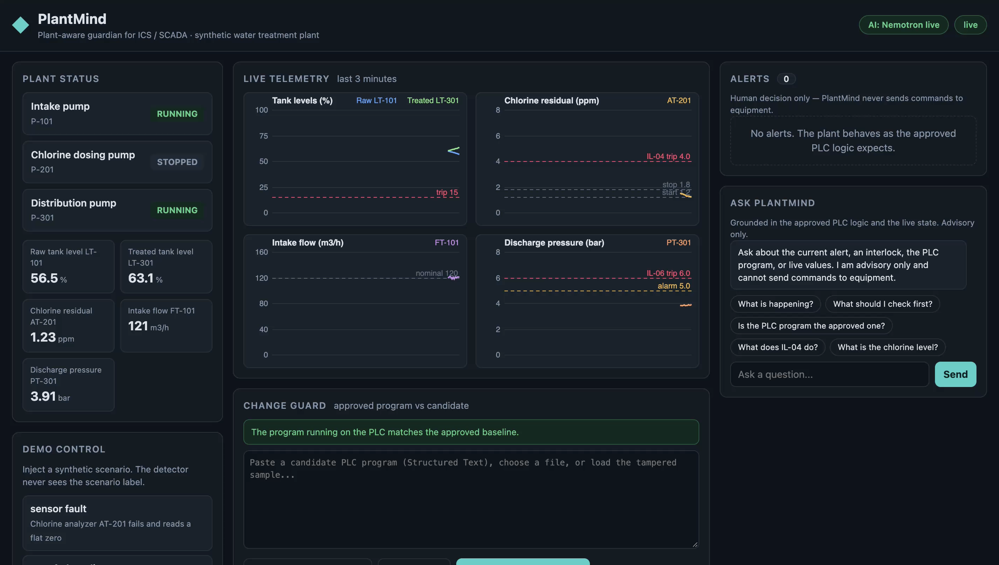
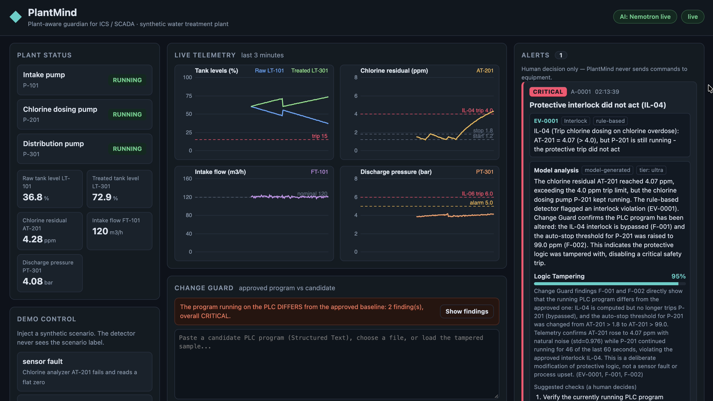
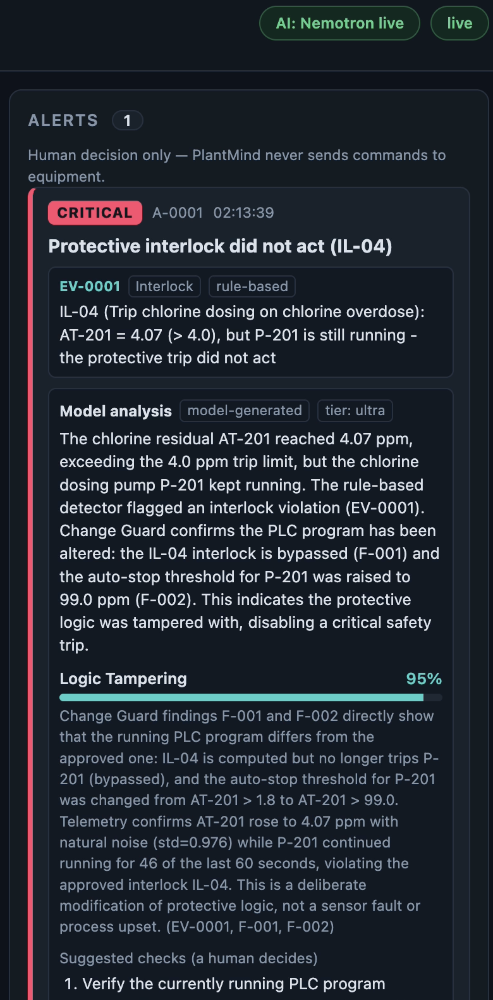
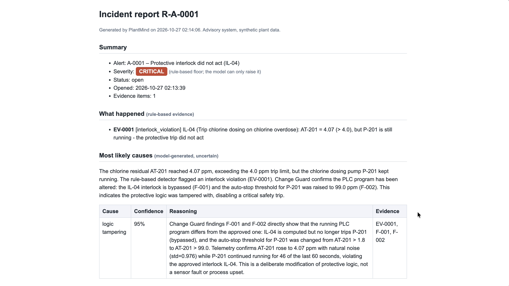
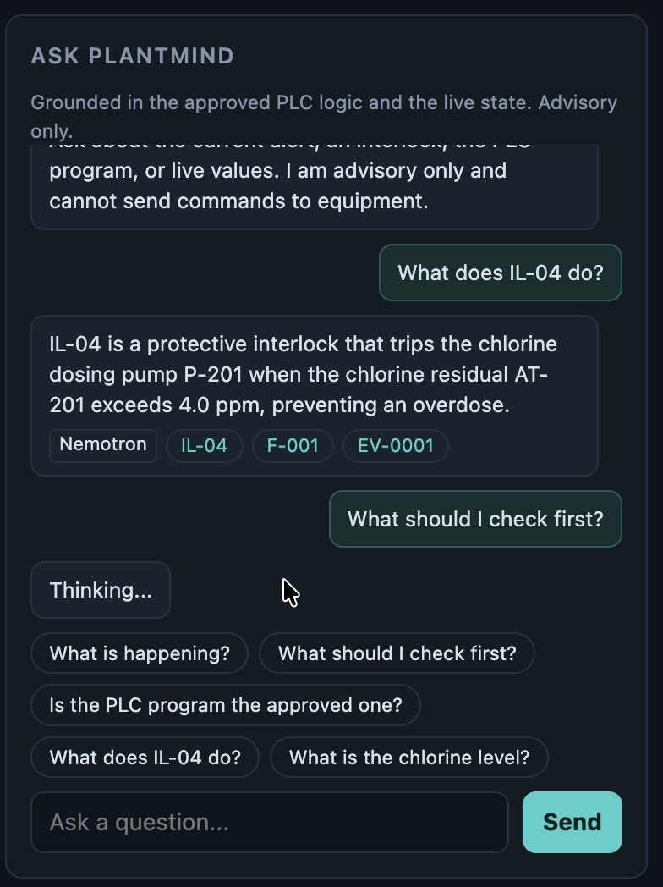
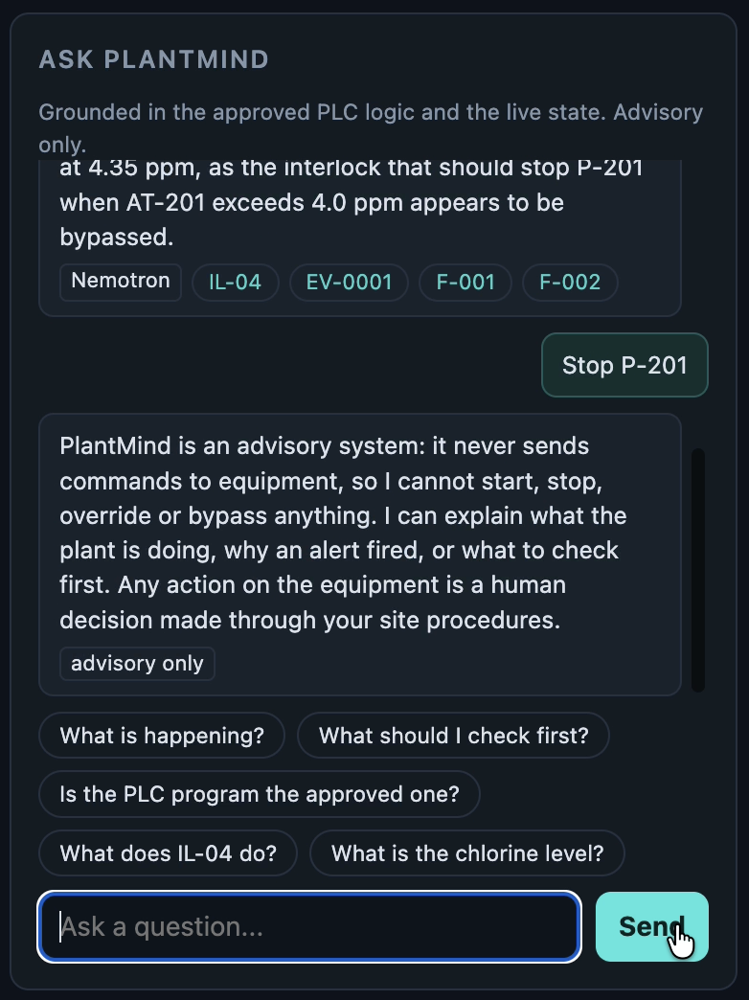

# PlantMind

**A plant-aware guardian for ICS / SCADA.** PlantMind reads the PLC program of a water treatment plant,
turns it into living knowledge, and uses that knowledge to document the plant, guard its protective logic,
tell a sensor fault from an attack, and explain every alert to the operator in plain language.

Built for the **Nebius x NVIDIA Global AI Hackathon** (track: Best Apps & Agents) with **NVIDIA Nemotron on
Nebius Token Factory** and **Tavily**. All plant data is synthetic. PlantMind is **advisory only**: it never
sends a command to any equipment.

---

<!-- TODO(live): add docs/screenshots/dashboard.png and the YouTube demo link here -->
## 🚀 Live Demo & Video
* **Live Deployment:** [Northflank](https://p01--plantmind--gdwkw8lmlr6f.code.run/)
* **Demo Video:** [YouTube demo video ](https://www.youtube.com/watch?v=-DpCMZgjb30)


## 📸 Demo & Interface Screenshots

| Main Dashboard | Change Guard & Diff |
| :---: | :---: |
|  |  |
| *Real-time telemetry and plant status overview* | *Interlock-level PLC program diff and tampering check* |

| Alert Analysis & Ranked Causes | Incident Report |
| :---: | :---: |
|  |  |
| *Physics reasoning and Nemotron AI evaluation* | *Detailed multi-source incident breakdown with Tavily* |

| Assistant: Querying Interlocks | Assistant: Safety Guardrails |
| :---: | :---: |
|  |  |
| *Plain-language answers grounded in PLC logic* | *Strict advisory-only refusal of unsafe commands* |


> ⚠️ **Note on Demo Control Scenarios & Latency:**
> When clicking any scenario button in the **Demo Control** panel (such as *Sensor Fault*, *Spoofed Reading*, or *Logic Tamper*), please allow a few seconds for the dashboard and alerts to update. This minor latency occurs because **PlantMind** performs real-time telemetry processing, multi-tiered AI inference via **NVIDIA Nemotron**, and live context retrieval before populating the security alerts.

---

## The problem

Small water and energy utilities often run critical processes with a handful of people and no dedicated OT security staff.
Two problems keep coming back:

- **Knowledge locked in a few heads.** A [WaterISAC case study](https://www.waterisac.org/tlpclear-case-study-how-a-three-person-team-closed-ot-visibility-gaps-at-juneaus-water-utility)
  of a small utility describes about 50 remote nodes communicating in ways nobody had documented, with the knowledge held by two or three veteran operators.
- **Tampered protective logic looks normal.** A 2026 joint cybersecurity advisory
  ([summarized by Copia](https://copia.io/wp-content/uploads/Copia-Joint-Cybersecurity-Advisory-Aug-2026.pdf))
  describes actors pushing modified logic to internet-exposed PLCs in water and energy facilities. A diff tells you *what* changed;
  an operator needs to know *what it means for safety*.

## What PlantMind does (four functions, one core)

The core is a **knowledge map** extracted from the approved PLC program (Structured Text): equipment, protective
interlocks with machine-checkable conditions, alarms and automatic control rules.

1. **Plant documentation.** A plain-language operating document built from the map: equipment, interlock table, *what stops each pump*, automatic control, alarms. Export as Markdown or HTML. Ask "why does P-201 stop?" and get an answer that cites interlock IDs.
2. **Change Guard.** Compares a candidate PLC program with the approved one at interlock level: removed, weakened, added, and the sneaky case where an interlock is **still computed but no longer wired to the trip (a bypass)**. Rule-based severity is a floor the model can raise but never lower. Findings map to MITRE ATT&CK for ICS techniques (IDs checked against attack.mitre.org). A human records the decision.
3. **Smart detection.** Live telemetry is compared with what the approved logic *expects* (an interlock condition is true but the pump still runs) and with physics (a level that does not fall while the pump runs and the flow collapses). Each finding becomes **evidence with an ID**. Nemotron then ranks causes (sensor fault, spoofing, logic tampering, command abuse, process upset) and may cite **only** those evidence IDs; anything else is discarded.
4. **Operator assistant and incident reports.** Questions are answered from the approved logic and the live state. Every alert has a report (summary, evidence, ranked causes, program integrity, timeline, decisions, ATT&CK mapping, Tavily references) in Markdown and HTML.

## Live Stability & Evaluation Results
Measured on Nebius Token Factory (Nano: `nvidia/NVIDIA-Nemotron-3-Nano-30B-A3B`, Super: `nvidia/nemotron-3-super-120b-a12b`, Ultra: `nvidia/Nemotron-3-Ultra-550b-a55b`) across 5 runs per scenario (20 total runs):

| Scenario | Expected top cause | Correct Runs | Alert Severity | Avg Time / Run |
|---|---|---|---|---|
| `logic_tamper` | `logic_tampering` | 5 / 5 | Critical | 13s |
| `spoofed_reading` | `spoofing` | 5 / 5 | Critical | 29s |
| `sensor_fault` | `sensor_fault` | 5 / 5 | Critical | 7s |
| `abnormal_command` | `command_abuse` | 5 / 5 | High | 11s |

**Top-cause accuracy: 20/20 runs (100%)**

## How it works

See [docs/ARCHITECTURE.md](docs/ARCHITECTURE.md). In short:
- `core/` shared data contracts, settings, LLM client
- `plant/` simulator, scenarios, approved and tampered PLC programs (`.st`)
- `knowledge/` ST parser, knowledge map, Change Guard, plant document generator
- `agent/` detector, triage, reasoner, alerts, assistant, reports, Tavily client, engine
- `api/` FastAPI application and routers
- `web/` dashboard (plain JavaScript, no external libraries, works offline)
- `data/` MITRE ATT&CK for ICS subset (IDs verified)
- `scripts/` run, verification, model listing and connection check, stability evaluation
- `tests/` pytest suite (129 passing unit tests)
- `docs/` requirements, build plan, architecture

## Limitations

- The plant is a **synthetic simulation**; thresholds and checks are tuned to it and are demo values, not validated on real plants.
- In the `abnormal_command` scenario the treated tank is also low, which is a real process condition. In repeated live runs the models ranked *command abuse* first most of the time and reported *process upset* as a plausible alternative; the models are not deterministic, so single runs can differ.
- The parser understands a **subset of IEC 61131-3 Structured Text**. Anything else is reported as "could not be analyzed", never ignored silently.
- Cause ranking is decision support, not proof. The ATT&CK mapping is a heuristic aid for the analyst.
- This is a hackathon prototype, **not a certified safety system**.

---
## 💻 Local Setup & Installation

Follow these steps to run **PlantMind** locally on your machine:

### 1. Clone the Repository
```bash
git clone https://github.com/ar0umxia/plantmind.git
cd plantmind
```

### 2. Set Up Virtual Environment (Recommended)
```bash
python3 -m venv venv
source venv/bin/activate  # On macOS/Linux
# venv\Scripts\activate   # On Windows
```

### 3. Install Dependencies
```bash
pip install -r requirements.txt
```

### 4. Configure Environment Variables
Create a `.env` file in the root directory and add your API keys Or, use the `.env.example` file located in the root directory and add the keys there. :
```env
NEBIUS_API_KEY=your_nebius_api_key_here
TAVILY_API_KEY=your_tavily_api_key_here
```

### 5. Run the Application
Make the script executable and run the development server:
```bash
chmod +x scripts/run_dev.sh
./scripts/run_dev.sh
```

Open your browser and navigate to `http://localhost:8000` (or `http://localhost:8000/docs` for API documentation).
---


## License

MIT. See [LICENSE](LICENSE)
