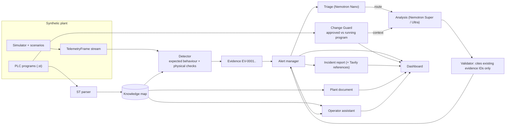

# PlantMind - Architecture

## Data flow

## Layers

| Layer | Modules | Rule |
|---|---|---|
| Contracts | `core/contracts.py` | Typed models shared by everything; changes bump `CONTRACT_VERSION` |
| Plant | `plant/` | Simulator mirrors `water_plant_baseline.st`; programs are analysed, never executed |
| Knowledge | `knowledge/` | Deterministic parsing; interlocks not wired to a trip get target `UNWIRED` |
| Detection | `agent/detector.py`, `expected_behavior.py`, `physical_checks.py` | No model, no network; never reads the scenario label |
| Analysis | `agent/triage.py`, `reasoner.py`, `analysis.py` | Models explain and rank; rules set the floor; IDs validated |
| Experience | `agent/assistant.py`, `report_generator.py`, `api/`, `web/` | Advisory only; every output labelled by source |

## Safety invariants (and the tests that guard them)

1. The system never actuates equipment; command requests to the assistant are refused before any model call (`test_command_requests_are_refused_without_calling_the_model`).
2. The model never lowers a rule-based severity (`test_apply_result_never_lowers_severity`, `test_model_can_raise_but_never_lower_and_unknown_ids_are_ignored`).
3. Model claims cite only existing evidence IDs (`test_validate_*` in `tests/test_analysis.py`).
4. Detection never reads the scenario label (`test_detector_never_uses_the_scenario_label`).
5. A model failure leaves rule-based results intact (`test_model_failure_*`).
6. A bypassed interlock is reported even when it is still computed (`test_tampered_program_bypass_and_setpoint_are_caught`).
7. Generated HTML escapes all dynamic text (`test_html_report_escapes_everything_dynamic`).
8. Inputs are bounded (`test_guard_rejects_empty_and_oversized_input`, `test_assistant_endpoint_answers_blocks_and_validates`).

## Concurrency

The engine steps the simulator and detector in one background thread. Model calls (alert analysis,
Change Guard assessment) go to a second worker thread through a queue, so telemetry never waits for a model.
All shared state sits behind one re-entrant lock; model calls run outside the lock. Manual `step()` calls
(tests) run the same jobs inline.

## Operating modes

| Mode | Settings | Behaviour |
|---|---|---|
| Offline demo | `MOCK_LLM=1`, `MOCK_TAVILY=1` | Deterministic stand-ins, labelled in the UI and in every export |
| Live | `MOCK_LLM=0`, `MOCK_TAVILY=0` + keys | Nemotron on Nebius Token Factory, Tavily search |
